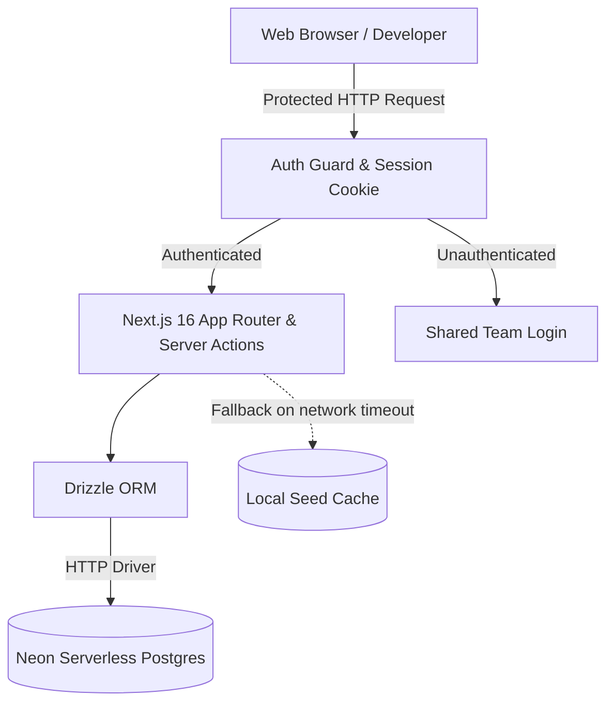

# ⚡ Service Hub — Internal Developer Portal & Microservices Catalog

> A lightning-fast, secure, and modern developer catalog engineered for engineering teams to manage, discover, and monitor internal microservices, API gateways, dashboards, and enterprise tools across all environments.

[](https://nextjs.org/)
[](https://react.dev/)
[](https://neon.tech/)
[](https://orm.drizzle.team/)
[](https://tailwindcss.com/)
[](LICENSE)

---

## 🚀 Key Features

- **🌐 Centralized Services Catalog**: Over 65+ microservices, Swagger documentation endpoints, Kibana loggers, event buses, and enterprise portals organized into a single dashboard.
- **🛡️ Zero-Leakage Team Authentication**: Shared team credentials authenticated server-side with HMAC-signed `httpOnly` session cookies. Unauthenticated requests receive empty payloads to prevent internal URL/infrastructure leakage.
- **⚡ Neon Serverless Postgres & Drizzle ORM**: Real-time cloud persistence powered by `@neondatabase/serverless` over HTTP with Drizzle ORM type-safety and instant branch workflows.
- **🗂️ Multi-Environment Filtering**:
  - `Develop` (Commerce, Admin, Vendor, Swaggers, Kibana, CAP messaging, Hangfire)
  - `Test` (QA & Test environments, test swaggers, and test tools)
  - `Stage` (Production replica & pre-release staging services)
  - `DevOps & Tools` (Harbor registry, SonarQube, Grafana, Portainer, Vault, Consul, Redis Commander)
  - `Portals & HR` (GitLab, Jira, Confluence, ERP, HRM, ticketing systems)
- **🔍 High-Speed Search & Categorized Select**: Search by service name, description, owner team, or URL, combined with categorized dropdown filters and custom dynamic table pagination.
- **🛠️ Complete CRUD Management**: Add new services, edit endpoints/owners/statuses, and delete deprecated tools with server actions.
- **🌓 Light / Dark / System Themes**: Flawless theme toggle integrated with `next-themes` and CSS variables.
- **🧭 Interactive Onboarding & Docs**: Multi-step interactive tour modal and dedicated `/onboarding` architectural documentation page.
- **🛡️ Enterprise Reliability**: Server actions feature fallback resilience with timeout protection so the UI never hangs even under restricted outbound connectivity.

---

## 🏗️ Architecture



---

## 📦 Tech Stack

- **Framework**: [Next.js 16](https://nextjs.org/) (Turbopack, App Router, React 19)
- **Database**: [Neon Serverless PostgreSQL](https://neon.tech/)
- **ORM**: [Drizzle ORM](https://orm.drizzle.team/) & [Drizzle Kit](https://orm.drizzle.team/kit-docs/overview)
- **UI Components**: [Shadcn UI](https://ui.shadcn.com/) & [@base-ui/react](https://base-ui.com/)
- **Styling**: [Tailwind CSS v4](https://tailwindcss.com/)
- **Icons**: [Lucide React](https://lucide.dev/)
- **Theme**: [next-themes](https://github.com/pacocoursey/next-themes)

---

## 🛠️ Getting Started

### 1. Clone Repository
```bash
git clone https://github.com/alireza-akbarzadeh/service-hub.git
cd service-hub
```

### 2. Install Dependencies
```bash
pnpm install
```

### 3. Configure Environment Variables
Create a `.env.local` file in the root directory:
```env
# Neon Database Connection
DATABASE_URL="postgresql://neondb_owner:<PASSWORD>@<ENDPOINT>.us-east-2.aws.neon.tech/neondb?sslmode=require"
DATABASE_URL_UNPOOLED="postgresql://neondb_owner:<PASSWORD>@<ENDPOINT>.us-east-2.aws.neon.tech/neondb?sslmode=require"
NEON_BRANCH="production"

# Team Authentication
AUTH_TEAM_NAME="frontend_team"
AUTH_TEAM_PASSWORD="YourSecurePasswordHere"
AUTH_SESSION_SECRET="your-32-character-random-secret-key"
```

### 4. Push Schema & Seed Catalog
```bash
# Push schema to Neon Postgres
pnpm drizzle-kit push

# Seed the initial 65 services
pnpm seed
```

### 5. Run Development Server
```bash
pnpm dev
```
Open [http://localhost:3000](http://localhost:3000) to access the dashboard.

---

## 🔐 Authentication Guide

For lightweight team access without heavy identity provider setup:
1. Provide the shared `AUTH_TEAM_NAME` and `AUTH_TEAM_PASSWORD` in `.env.local`.
2. Accessing the dashboard prompts for team credentials.
3. Upon validation, an HMAC-signed `httpOnly` cookie (`team_session`) is set.
4. If unauthenticated, server actions return zero links or sensitive data, ensuring full protection against inspection or scraping.

---

## 📄 License
MIT License. Created for internal engineering agility and microservice governance.
