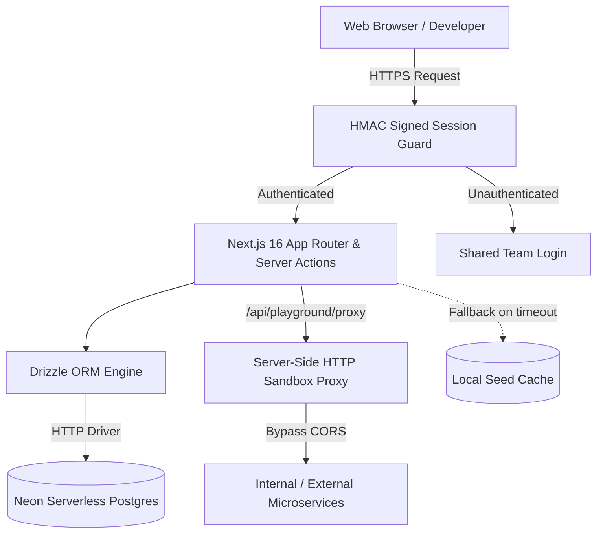

# ⚡ Service Hub — Internal Developer Portal & Microservices Catalog

> A lightning-fast, secure, and modern developer workspace engineered for software engineering squads to discover microservices, run API sandboxes, track 30-day SLA uptimes, visualize architecture call graphs, review PRs, and streamline everyday developer utilities.

[](https://nextjs.org/)
[](https://react.dev/)
[](https://neon.tech/)
[](https://orm.drizzle.team/)
[](https://tailwindcss.com/)
[](https://www.typescriptlang.org/)
[](LICENSE)

---

## 🌟 Key Platform Modules & Epics

### 1. 🌐 Centralized Microservice Catalog & Dashboard
- **65+ Registered Microservices**: Ingress gateways, core eCommerce services, event streaming buses, Redis caches, and observability portals.
- **3 Adaptive View Modes**: Tabular dense view, expansive horizontal row cards, and modular square grid cards.
- **Multi-Environment Isolation**: Filter across `Develop`, `Test`, `Stage`, `DevOps & Tools`, and `Portals & HR`.
- **Customizable Dashboard**: Pinned favorites, recently launched services, pending reviews widget, and market rates strip.

### 2. ⚡ In-Browser API Playground & REST Sandbox (`/playground`)
- **Full HTTP Client**: Support for `GET`, `POST`, `PUT`, `PATCH`, `DELETE`, `HEAD`, and `OPTIONS`.
- **CORS Bypass Server Proxy**: Executes requests securely via `/api/playground/proxy` with 12s timeout protection.
- **Multi-Language Exporter**: Instant snippets in **cURL**, **Fetch (JS/TS)**, **Axios**, **Python (`requests`)**, and **Go (`net/http`)**.
- **Auth Presets & Templates**: Bearer tokens, Basic auth, API keys, JSON body templates, and execution history.

### 3. 📊 Dedicated System Status Page & SLA Observability (`/status`)
- **30-Day SLA Heatmaps**: 30 discrete daily status blocks per service with hover tooltips detailing date, uptime %, and latency.
- **Batch Health Ping Probe**: Concurrently probe catalog services with live progress bar and latency gauges.
- **Incident & Maintenance Timelines**: Triage logs, root-cause post-mortems, and scheduled kernel/storage maintenance windows.

### 4. 🕸️ Microservice Topology & Architecture Dependency Graph (`/topology`)
- **4-Tier Call Graph**: Visual call paths across Client Gateways, Ingress Proxies, Core Services, and Data/Telemetry nodes.
- **Deep Inspection**: Interactive focus mode dimming non-connected nodes, showing upstream callers and downstream dependencies.
- **Architecture Export**: Instant **Mermaid.js** flowchart diagram copy and high-resolution vector **SVG** export.

### 5. 📦 Export & Developer Sync Suite
- **Postman Collection v2.1.0**: Hierarchical folders, parameterized host variables, and health assertion scripts.
- **OpenAPI 3.0.3**: Validated YAML/JSON specification documents ready for Swagger UI or API gateways.
- **RFC 4180 CSV & JSON Backups**: Full catalog exports for staging synchronization and reporting.

### 6. 📜 Activity Feed & Enterprise Audit Trail (`/activity`)
- **Real-Time Audit Log**: Chronological stream of service registrations, metadata updates, PR merges, and IAM role elevations.
- **Squad Filtration & CSV Export**: Filter by engineering squad (*Platform*, *Frontend*, *Security*, *Infrastructure*) and export audit logs.

### 7. 🛠️ Developer Tools Suite (`/tools`, `/tools/advanced`, `/tools/web`)
- **Standard Tools**: JSON Formatter & Tree Inspector, JWT Debugger, cURL Command Inspector, Base64 & Hash Generators.
- **Advanced Tools**: Client-side Image Compressor & WebP Converter, RegEx Evaluator, Git-style Diff Checker, Cron Explainer, Color & Tailwind Palette Generator, SQL Beautifier, QR Code Generator.
- **Internet Launchpad**: 24+ categorized dev tool shortcuts (Transform.tools, Ray.so, CyberChef), Epoch/Unix Clock, URL/UTM Builder, UUID/NanoID Generator, and HTTP Status Codes reference.

### 8. 🔐 Environment Variables & Secrets Studio (`/env`)
- **Split-Pane .env Workbench**: Raw `.env` text synchronized live with structured key-value table and secret masking (`••••••••`).
- **Multi-Environment Diff Matrix**: Compare `Development`, `Staging`, and `Production` side-by-side to catch missing keys or value drift.
- **Kubernetes & Docker Generator**: 1-click serialization to **Docker Compose** (`environment:` YAML), **Kubernetes ConfigMap**, **Kubernetes Secret** (Base64 encoded), and JSON.
- **100% In-Memory Privacy**: Zero-leakage architecture ensures no environment variables or credentials leave local memory.

### 9. 🤝 Coworker Collaboration, PRs & Community
- **Requests & PRs Kanban Board (`/requests`)**: Triage feature requests, bug reports, and coworker PR reviews with diff previews and upvoting.
- **Access Management & Users (`/users`)**: Role-based access control (`Admin`, `Manager`, `Developer`, `Viewer`) and squad directories.
- **Iran Time & Calendar Sync (`/calendar`)**: Real-time Tehran local time (IRST) converter, meeting reminders, and instant Google Meet launcher.
- **Anonymous Chat Lounge (`/chat`)**: Multi-channel team chat (`#general`, `#cs2-game`, `#music`) with live reactions.

---

## 🏗️ Architectural Topology



---

## 🧭 Routes Map

| Route | Purpose | Access |
| :--- | :--- | :---: |
| `/` | Personalized Microservices Catalog Dashboard | Authenticated |
| `/playground` | In-Browser HTTP Client & REST Request Sandbox | Authenticated |
| `/status` | System Status Page, 30-Day SLA Heatmaps & Incident Triage | Authenticated |
| `/topology` | Microservice Architecture & Dependency Call Graph | Authenticated |
| `/activity` | Enterprise Activity Stream & Compliance Audit Trail | Authenticated |
| `/env` | Environment Variables Studio, Multi-Env Diff & K8s Generator | Authenticated |
| `/tools` | Standard Dev Tools (JSON, JWT, cURL, Base64, Hash) | Authenticated |
| `/tools/advanced` | Advanced Tools (Image, RegEx, Diff, Cron, SQL, QR) | Authenticated |
| `/tools/web` | Internet Launchpad, Unix Epoch, URL/UTM, UUID, Markdown | Authenticated |
| `/requests` | Feature Requests & Bug-Fix PRs Kanban Board | Authenticated |
| `/users` | Access Management & User Role Directory | Authenticated |
| `/calendar` | Tehran Time Sync & Google Meet Collaboration | Authenticated |
| `/chat` | Anonymous Engineering Chat Lounge | Authenticated |
| `/ai` | Curated AI Directory & Developer Prompts | Authenticated |

---

## 🛠️ Getting Started

### 1. Clone Repository
```bash
git clone https://github.com/alireza-akbarzadeh/service-hub.git
cd service-hub
```

### 2. Install Dependencies
```bash
npm install
```

### 3. Configure Environment Variables
Create a `.env.local` file in the root directory:
```env
# Neon Database Connection
DATABASE_URL="postgresql://neondb_owner:<PASSWORD>@<ENDPOINT>.us-east-2.aws.neon.tech/neondb?sslmode=require"
DATABASE_URL_UNPOOLED="postgresql://neondb_owner:<PASSWORD>@<ENDPOINT>.us-east-2.aws.neon.tech/neondb?sslmode=require"
NEON_BRANCH="production"

# Team Authentication
AUTH_TEAM_NAME="frontend_team"
AUTH_TEAM_PASSWORD="YourSecurePasswordHere"
AUTH_SESSION_SECRET="your-32-character-random-secret-key"
```

### 4. Push Schema & Seed Catalog
```bash
# Push schema to Neon Postgres
npx drizzle-kit push

# Seed the initial 65 services
npx tsx scripts/seed.ts
```

### 5. Run Development Server
```bash
npm run dev
```
Open [http://localhost:3000](http://localhost:3000) to access the dashboard.

### 6. Verify Production Build
```bash
npm run typecheck
npm run build
```

---

## 🔐 Zero-Leakage Security Model

1. Shared team credentials validated server-side using secure HMAC-signed cookies (`team_session`).
2. Unauthenticated visitors receive empty service lists to prevent internal IP, staging URL, or architecture leakage.
3. Outbound proxy requests enforce strict 12-second timeouts and header validation.

---

## 📄 License
MIT License. Engineered for internal engineering agility and microservice governance.
